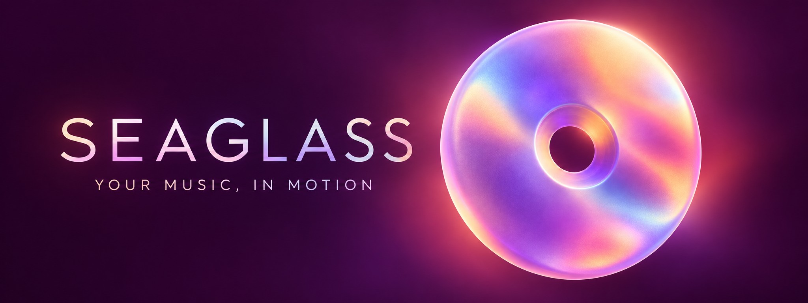
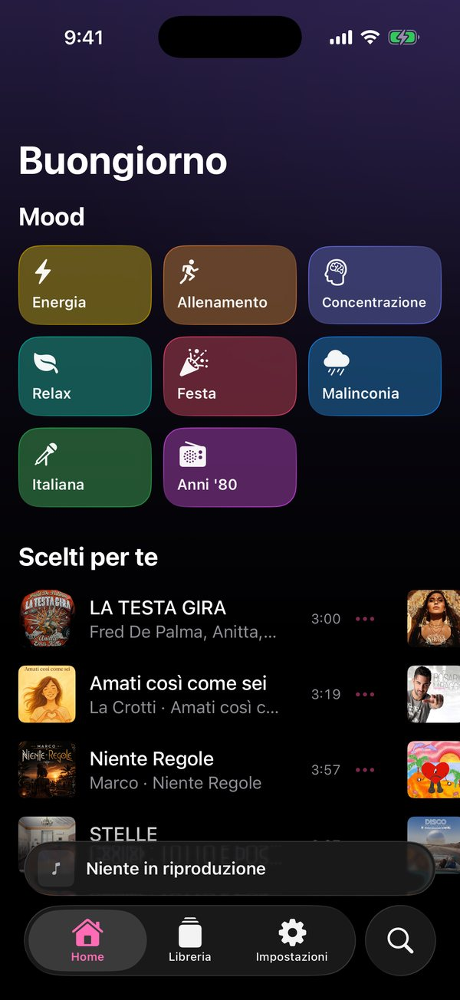
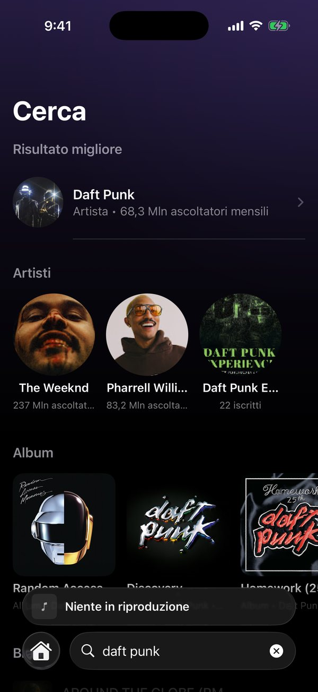
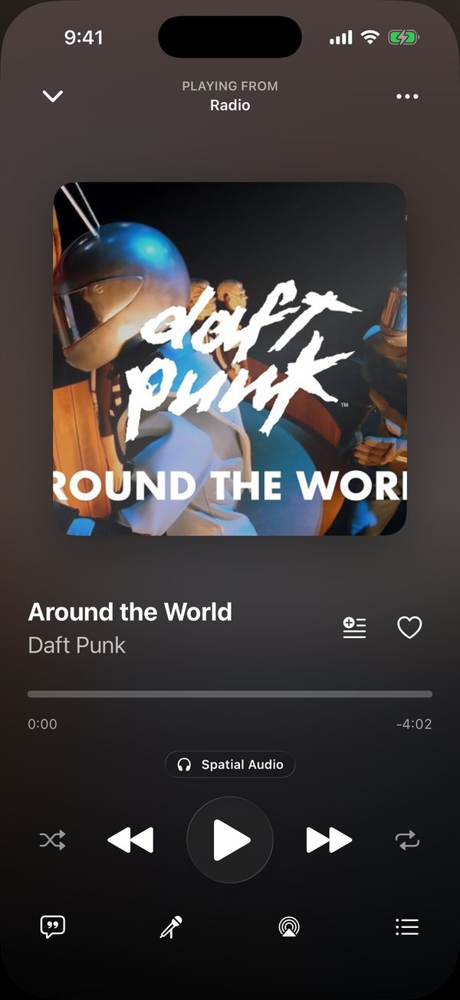
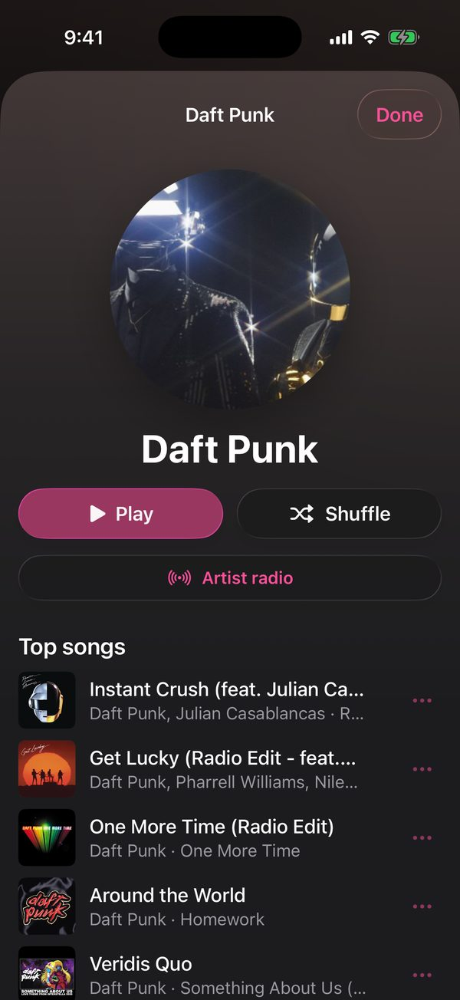
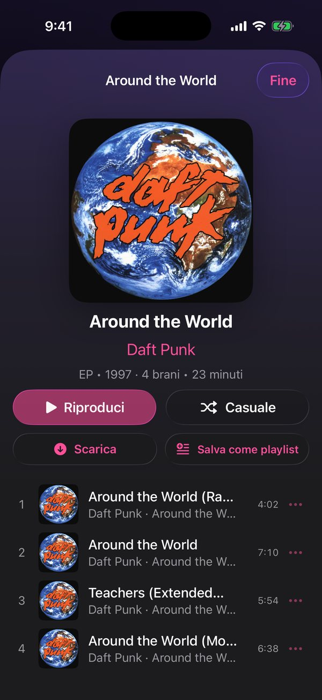
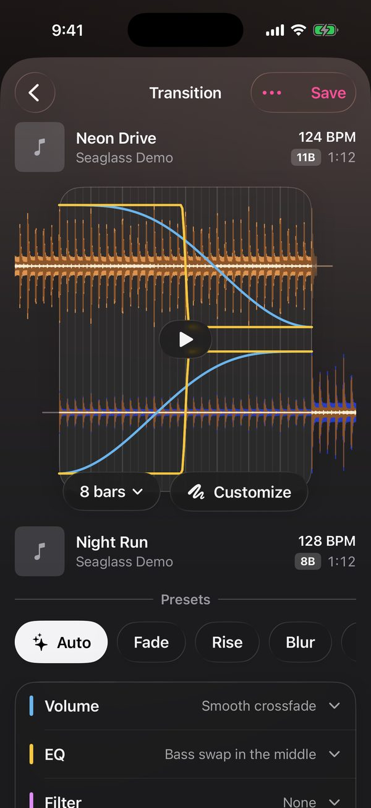
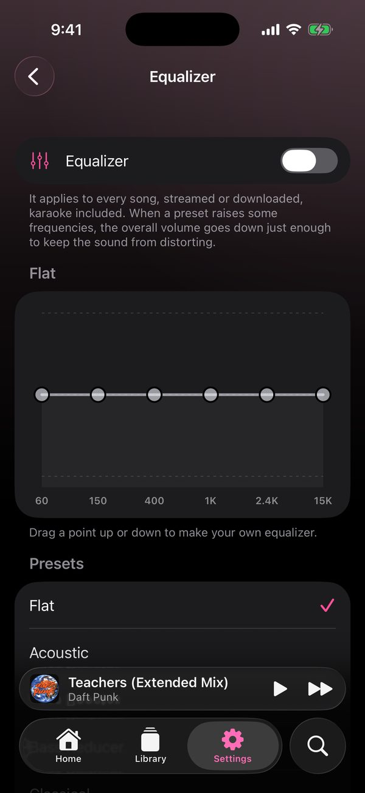
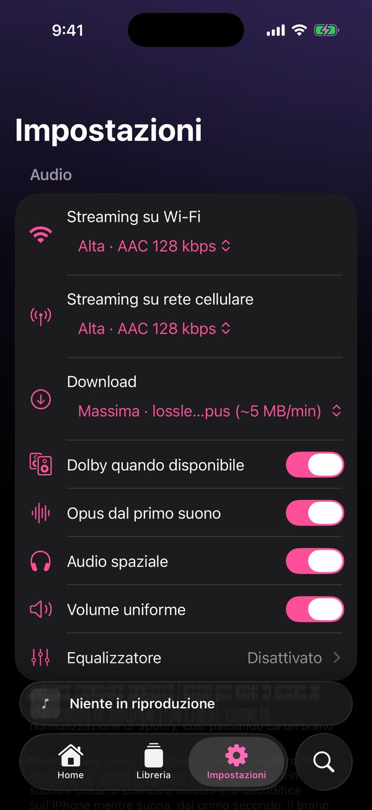

<p align="center">
  
</p>

<h1 align="center">Seaglass <sub>formerly Onda</sub></h1>

<p align="center"><strong>Your music, your rhythm.</strong><br>
An independent music player for iPhone, with AutoMix, playlists and synced lyrics.</p>

<p align="center">
  <a href="https://github.com/Foglio24/onda/releases/latest/download/Seaglass.ipa"></a>
  <a href="https://altdirect.app/?url=https%3A%2F%2Fraw.githubusercontent.com%2FFoglio24%2Fonda%2Fmain%2Faltstore-source.json&amp;r=altstore"></a>
  <a href="https://github.com/Foglio24/onda/releases/latest"></a>
  <a href="https://github.com/Foglio24/onda/releases"></a>
</p>

<p align="center">
  <a href="#discover-seaglass">Features</a> · <a href="#screenshots">Screenshots</a> ·
  <a href="#installation">Installation</a> · <a href="#frequently-asked-questions">FAQ</a> ·
  <a href="CHANGELOG.md">Changelog</a>
</p>

## Discover Seaglass

**Seaglass**, formerly known as Onda, is a music app for iPhone that uses the YouTube Music catalogue. It brings together background playback, a personal library and tools for transitioning between songs: an independent alternative for listeners who want a customisable experience.

### Your music, in motion

- **AutoMix** analyses songs and chooses a suitable transition. When the rhythm allows, it tries to align the beats by gradually changing tempo without changing pitch; for less compatible songs it can choose another type of transition.
- **Playlist Mix** automatically transitions through a playlist. For downloaded songs, you can also customise transitions using waveforms, volume, EQ and effects.
- **Adjustable audio quality** for Wi-Fi, mobile data and downloads. Maximum quality can use Opus; Dolby Digital Plus or AAC may be used when available. The actual format depends on the song and device conditions.
- **Equaliser and volume normalisation** let you tailor your listening experience.

### A library of your own

- Search songs, artists and albums; save favourites, create playlists and organise your queue.
- Download songs, albums and playlists for offline listening and check storage usage in settings.
- Import playlists from Spotify, Apple Music and YouTube links. If a song cannot be matched, review the import report and choose a suggested alternative.
- Public Spotify links may expose only the first 100 songs. For longer playlists, import a Spotify JSON or CSV file from **Library → Import playlist from file**.
- Discover radio stations and personalised mixes; connect Last.fm for scrobbling and more features based on your listening.

### Follow along and sing

- **Synced lyrics** from LRCLIB, with automatic scrolling and tap-to-seek.
- **Lyrics translation** using Apple's tools when the language is available on your device.
- **AI karaoke** to adjust vocals and accompaniment. Processing takes place on your iPhone and may take time.
- Controls on the Lock Screen, in Control Center and through AirPlay; interface available in English and Italian.

## Screenshots

<table>
  <tr>
    <td align="center"><br><sub>Home</sub></td>
    <td align="center"><br><sub>Search</sub></td>
    <td align="center"><br><sub>Player</sub></td>
    <td align="center"><br><sub>Artist</sub></td>
  </tr>
  <tr>
    <td align="center"><br><sub>Album</sub></td>
    <td align="center"><br><sub>Playlist Mix</sub></td>
    <td align="center"><br><sub>Equaliser</sub></td>
    <td align="center"><br><sub>Settings</sub></td>
  </tr>
</table>

<sub>Screenshots were created in the iOS simulator. Artwork, names and music belong to their respective rights holders.</sub>

## Installation

**Requirements:** an iPhone running iOS 26 or later. The IPA is **unsigned**: you need to sign and install it with a sideloading tool such as Sideloadly, AltStore Classic or SideStore.

1. [Download the latest Seaglass.ipa](https://github.com/Foglio24/onda/releases/latest/download/Seaglass.ipa).
2. Open the file in your chosen sideloading tool and follow its instructions to sign and install it.
3. If prompted, enable **Developer Mode** in Settings → Privacy & Security and trust the profile in Settings → General → VPN & Device Management.

With a free Apple ID, the signature may expire after 7 days and need to be renewed. Renewal depends on your sideloading tool. Seaglass is not published on the App Store or AltStore PAL.

### Install from AltStore Classic

[Add the source to AltStore Classic](https://altdirect.app/?url=https%3A%2F%2Fraw.githubusercontent.com%2FFoglio24%2Fonda%2Fmain%2Faltstore-source.json&r=altstore) using AltDirect, a third-party redirect, or open **Browse → Sources → +** in AltStore Classic and paste:

```text
https://raw.githubusercontent.com/Foglio24/onda/main/altstore-source.json
```

Open Seaglass in the source to install it or check for updates. AltStore signs the IPA using your Apple ID; with a free account, the signature needs regular renewal through AltServer.

### Updates

The app can check GitHub for new releases and notify you or download the IPA to the Files app. Installing an update remains a manual step using your sideloading tool. See the [changelog](CHANGELOG.md) for the complete release history.

## Frequently asked questions

**Why is the audio format not always Opus?**  
Availability varies by song. The app can use an alternative format, for example when Dolby is available or Opus decoding cannot be used. Check the format shown in the player and the diagnostics in settings.

**Does AutoMix always use beat matching?**  
No. It tries to favour transitions in time when they suit the songs, but can choose another transition if their rhythms or vocals make a mix unsuitable.

**Why are songs missing after an import?**  
Some recordings may not be found or matched with sufficient confidence. Open the import report to see missing songs and choose available alternatives. For long Spotify playlists, use the file import described above.

**What does the download counter measure?**  
It adds downloads of `Onda.ipa` and `Seaglass.ipa` from published GitHub releases. It refreshes periodically and does not represent the number of users or installations.

**How can I report a problem?**  
Open a [GitHub issue](https://github.com/Foglio24/onda/issues), including your app version, iPhone model and steps to reproduce the problem. When helpful, you can share a report from **Settings → Diagnostics**.

## Project details

Seaglass is written in Swift and SwiftUI. It uses YouTube Music for search and catalogue, YouTubeKit for audio links, LRCLIB for lyrics and Last.fm for scrobbling. Dependencies and acknowledgements are listed in [THIRD_PARTY_NOTICES.md](THIRD_PARTY_NOTICES.md).

GitHub Actions builds an unsigned IPA: the **Build IPA** workflow produces a downloadable artifact. Published releases and their notes are available on the [Releases page](https://github.com/Foglio24/onda/releases).

## Licence and notices

The source code is publicly viewable. You may download and install the app on your own devices for personal, non-commercial use; modification and redistribution require permission. See the [full licence](LICENSE).

Seaglass is an independent personal project, not affiliated with or endorsed by Google, YouTube, Spotify, Apple, Last.fm or LRCLIB. Music, artwork, lyrics and trademarks belong to their respective rights holders. Use of unofficial clients and downloading songs may be subject to the terms of the services used.
