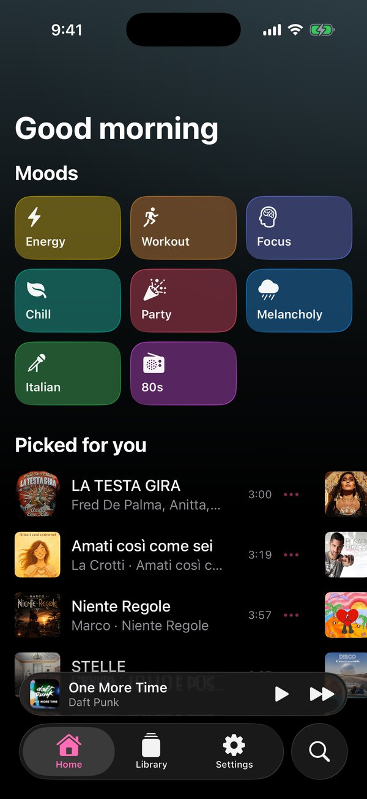
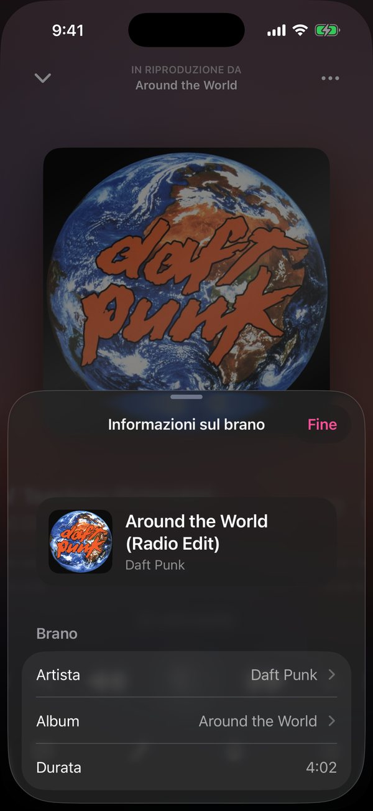

# Onda — YouTube Music player for iPhone

[](../../releases/latest)
[](https://github.com/Foglio24/onda/actions/workflows/build.yml)


**Onda** is a music player for iPhone that streams the YouTube Music catalogue: ad-free background
playback, **AutoMix** transitions between songs, Opus and Dolby audio, offline downloads, synced
lyrics, an equalizer, AI karaoke, smart radios and a **Last.fm scrobbler**, in Apple's Liquid Glass
design. It is installed as an **IPA** with Sideloadly, AltStore or SideStore (no App Store, no Mac
needed).

It is inspired by [LastWave](https://github.com/Clash-Projects/LastWave-Native) for Android and
written from scratch in Swift/SwiftUI, with no code from the original project. It runs on iOS 26
and later, including iPhone 17 Pro on iOS 27. The interface is in Italian and English and follows
the iPhone's language (English for any other language).

See [CHANGELOG.md](CHANGELOG.md) for what changed in each version.

## Screenshots

<table>
  <tr>
    <td align="center"><br><sub>Home</sub></td>
    <td align="center"><br><sub>Search</sub></td>
    <td align="center"><br><sub>Player</sub></td>
    <td align="center"><br><sub>Artist</sub></td>
  </tr>
  <tr>
    <td align="center"><br><sub>Album</sub></td>
    <td align="center"><br><sub>Playlist Mix editor</sub></td>
    <td align="center"><br><sub>Equalizer</sub></td>
    <td align="center"><br><sub>Settings</sub></td>
  </tr>
  <tr>
    <td align="center"><br><sub>In English</sub></td>
    <td align="center"><br><sub>Song details</sub></td>
    <td colspan="2"></td>
  </tr>
</table>

<sub>Taken on the iOS simulator by the build workflow (`Tools/Screenshots`). Artwork, names and music belong to their rights holders.</sub>

## Features

| LastWave (Android) | Onda (iOS) |
|---|---|
| Streams the YouTube Music catalogue, in the background and ad-free | ✅ |
| Search, artists and albums | ✅ Top result, artists, albums and songs; artist pages (top songs, albums, singles, videos, similar artists) and album pages |
| Volume normalization | ✅ Louder songs are turned down to YouTube's -14 LUFS reference, using YouTube's own loudness data |
| Equalizer | ✅ Spotify's presets on a six-band curve you can drag, on every song |
| Song details | ✅ Release date, label, ℗ and credits from YouTube Music's catalogue, plus format and loudness |
| Quality and codecs | ✅ Four levels, set separately for Wi-Fi, cellular and downloads (details below) |
| Dolby Atmos | ✅ Dolby Digital Plus when YouTube offers it, plus Apple's Spatial Audio with AirPods/Beats |
| Song transitions | ✅ AutoMix, inspired by Apple Music's: for each pair Onda weighs many transitions (beat-matched over 2–16 bars, short crossfades, into a fade-out, without silence, one after the other) by how steady the beats are where the songs meet, whether keys clash or two voices sing at once, loudness and how much tempo changes (at most 5 % per song), then renders the best ahead; albums played in order stay as they are. Or a 1–12 s crossfade |
| Playlist Mix | ✅ Like Spotify's Mix, for downloaded playlists: 2–16 bars, presets, volume, EQ, filters, reverb/echo, loops, beatmatching, lines drawn by hand, waveform editor with preview |
| Smart radios and mixes | ✅ A radio from any song, auto-radio when the queue ends, and recommendations that change every day from what you play, skip and like: six daily mixes, *Scelti per te* and moods; plus *Taste Mix* / *Rediscover* from Last.fm |
| Playlists | ✅ Create, rename, reorder, set a custom cover from Photos, download a whole playlist in one tap |
| Playlist import | ✅ From Spotify (up to 100 songs), Apple Music, YouTube and YouTube Music links; each song is matched on YouTube Music |
| Shuffle and repeat | ✅ A real shuffle mode (radios and mixes too), repeat all / repeat one, sleep timer |
| Last.fm scrobbler | ✅ Now playing, scrobble after half the song or 4 minutes, offline queue, likes synced |
| Synced lyrics from LRCLIB | ✅ Auto-scroll, tap a line to seek, 3 animations and 3 sizes |
| Offline downloads | ✅ Audio and artwork stored in the app, with the Music app's progress rings, whole albums and playlists in one tap, and a storage page by artist |
| Lock screen, Control Center, AirPlay | ✅ |
| Dynamic colours from the artwork | ✅ Every screen and the player are tinted with the album's colours |
| Theme colour | ✅ 11 preset accent colours |
| Instant start | ✅ Audio links in one quick request, the likely next song ready in advance on Wi-Fi (for Opus, its first seconds already decoded), links of songs on screen unlocked in the background, and playback starts with the first audio, Opus included |
| Library | ✅ Favourites, playlists, downloads, history, and an editable queue (drag, delete, shuffle) that comes back after a restart |

The quality levels are:
- **Maximum:** Opus ~160 kbps, decoded on the iPhone as it downloads and played from the first second. Dolby Digital Plus or 256 kbps AAC is used instead when the video has it.
- **High:** AAC 128 kbps.
- **Medium:** Opus ~70 kbps, played the same way.
- **Data saver:** AAC 48 kbps.

Wi-Fi and cellular default to **High (native AAC)** to avoid converting every streamed song on the phone. Existing explicit quality choices are preserved. Maximum remains available; Opus decoding and AI work stop when Low Power Mode is enabled or iOS reports a serious thermal state (AAC plays then, and says so). Only the first seconds of the next song (or of the one about to be tapped) are prepared ahead, on Wi-Fi; with AutoMix the next song is downloaded whole, as the mix needs it. Karaoke prepares the current song on demand. These limits reduce avoidable work; temperature and battery improvements still need measurement on an iPhone.

On every song, tap **···** for all actions, or swipe it like on Spotify: right to add it to the queue, left to add it to your favourites (tap the note that appears to pick a playlist instead).

Not included:
- **Universal scrobbler for other apps:** iOS doesn't let an app see what Spotify or Apple Music are playing.
- **Social feed:** may come later.
- **YouTube Music Premium formats (AAC 256 / Opus 256 on every song):** they require signing in with a Premium account.
- **CarPlay:** it needs an Apple entitlement that free accounts can't get.
- **USB DAC driver / bit-perfect output:** not possible on iOS.

## Installing

### Download the IPA

Grab `Onda.ipa` from the latest release on the [Releases](../../releases) page.

### How the IPA is built (no Mac needed)

GitHub Actions builds the IPA on a cloud Mac:

1. Push to `main` or a `feature/**` branch, or run **Build IPA** manually from the **Actions** tab.
2. After a few minutes, download the **Onda-ipa** artifact from the finished run.

Pushing a tag like `v1.2.0`, or running **Build IPA** by hand with **release** ticked, publishes a
release with the IPA, named and described from `CHANGELOG.md`: that is what the app's updater finds.

### Sideload it with Sideloadly (Windows or macOS)

1. On Windows, install iTunes and iCloud **from Apple's website**, not the Microsoft Store. Then install [Sideloadly](https://sideloadly.io).
2. Connect the iPhone with a USB cable and trust the computer.
3. Drag `Onda.ipa` into Sideloadly, enter your Apple ID and press **Start**. A free Apple ID works.
4. On the iPhone, turn on **Settings → Privacy & Security → Developer Mode** and restart.
5. In **Settings → General → VPN & Device Management**, trust your Apple ID.

With a free Apple ID the app expires after **7 days**. Re-sign it with Sideloadly; your data is kept.
[SideStore](https://sidestore.io) can refresh it from the iPhone itself.

### Updates

At every launch, or with **Impostazioni → Aggiornamenti → Cerca aggiornamenti**, Onda asks GitHub for the latest release. Choose what happens when there is a new one:

- **Avvisami:** a sheet shows the new version and its changelog, with buttons to download the IPA or open the release.
- **Scarica in automatico:** the IPA is saved straight away in the Files app, in **On My iPhone → Onda → Aggiornamenti**, then the same sheet appears.

Installing stays manual (Sideloadly, AltStore or SideStore): iOS doesn't let a sideloaded app replace itself.

### Connect Last.fm (optional)

1. Create an API application at <https://www.last.fm/api/account/create>.
2. In Onda, go to **Impostazioni → Last.fm**, paste the API key and shared secret, then tap **Connetti account Last.fm**.

## Troubleshooting

- **The GitHub build fails:** open the *Build (unsigned)* step of the run and look for lines containing `error:`.
- **"Brano non disponibile" on every song:** YouTube changed its player. Bump YouTubeKit in `project.yml` and rebuild.
- **Opus is never used at Maximum quality:** the format shown in the player says why AAC plays; Settings → Diagnostica keeps the last fallback, and Settings → Audio the last Opus error in orange.
- **The app no longer opens:** the 7-day signature expired. Re-sign it.

## How it's built

```
Onda/
  App/        app entry, tab bar, mini player, presentation routing
  Player/     AVPlayer engine, queue, AutoMix and crossfade, radio, lock screen, scrobbling
  Services/   YouTube Music (InnerTube), streams (YouTubeKit), Opus decoding,
              chunked downloads, LRCLIB, Last.fm, playlist import, library
  Views/      SwiftUI screens
project.yml   XcodeGen project (the .xcodeproj is generated in CI)
```

- **Search, radios and playlists** use YouTube Music's web API (the `WEB_REMIX` client).
- **Audio URLs** come from [YouTubeKit](https://github.com/alexeichhorn/YouTubeKit). Extraction runs on the phone. Only if that fails does it use the library author's server, which receives the video ID.
- **Opus** (WebM) is read as it downloads: the app takes the packets out of each piece, decodes them with Apple's own Opus decoder into PCM and serves a growing Core Audio file to AVPlayer through a resource loader (`OpusStream`). Downloads are decoded into Apple Lossless.
- **Lyrics** come from [LRCLIB](https://lrclib.net). **Scrobbling** uses the [Last.fm API](https://www.last.fm/api).

## License

Copyright © 2026 Foglio24. All rights reserved.

The code is public to read, not open source. You may download the released app and install it on your own devices for personal, non-commercial use. Copying, modifying or redistributing the code or the app, or using the name Onda for another app, needs written permission. See [LICENSE](LICENSE) for the full terms.

Work by others (YouTubeKit, the UVR karaoke model and the build tools) keeps its own licence: see [THIRD_PARTY_NOTICES.md](THIRD_PARTY_NOTICES.md).

## Disclaimer

Onda is a personal, non-commercial project. It is not affiliated with, endorsed by or sponsored by Google, YouTube, Spotify, Apple, Last.fm or LRCLIB. Their names are trademarks of their owners, and the music, artwork and lyrics belong to their rights holders.

Unofficial clients and downloading songs may break YouTube's Terms of Service, so use Onda for yourself only and at your own risk. It comes with no warranty.
